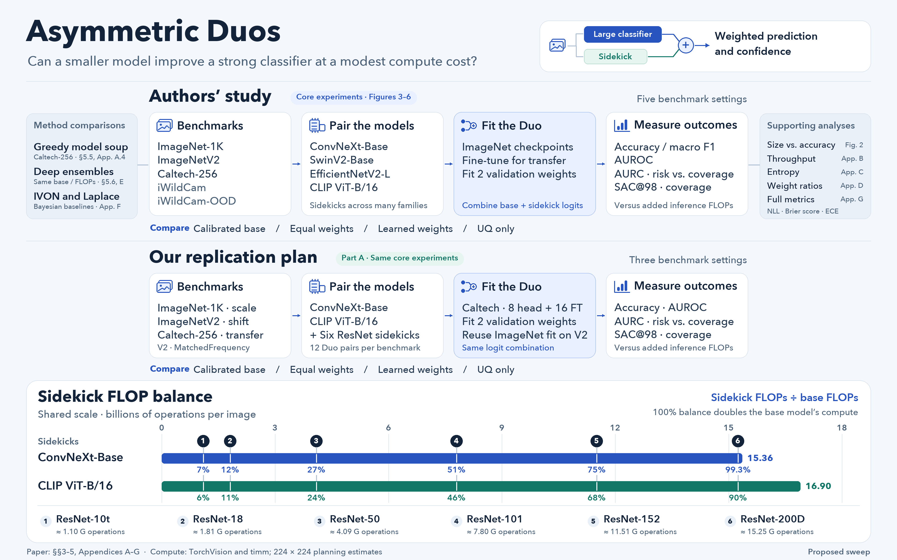

# DD2610 Final Project · Asymmetric Duos

## Introduction

An image classifier can have high accuracy and still be confidently wrong on individual images. We study whether a smaller classifier can help a larger model recognize its errors at a modest inference cost. We will reproduce the paper’s core experiments with the released implementation in Part A, then use a hosted LLM to reconstruct the method from the paper alone in Part B. Part B will also test whether changing the two models’ weights for each image improves uncertainty estimates.

This overview describes the research plan. Each implementation branch will have its own README with run instructions, findings, and deviations from the paper.

## Paper background

In [*Asymmetric Duos: Sidekicks Improve Uncertainty*](assets/asymmetric-duos-paper.pdf), Tim G. Zhou, Evan Shelhamer, and Geoff Pleiss pair a large image classifier with a cheaper classifier called a *sidekick*. Both models score the same image. The authors minimize validation negative log-likelihood to fit two weights that combine the logits into a class prediction and a confidence estimate. These weights are fixed across images in the paper’s method.

An ensemble of similarly sized classifiers adds roughly one model’s inference cost per extra member. The paper reports that cheaper sidekicks often improve accuracy, help distinguish correct predictions from errors, and let a classifier abstain more effectively. The authors observe improvements with about 10–20% extra FLOPs in many settings. We target the comparisons in Figures 3–6. The reference implementation is in the [authors’ GitHub repository](https://github.com/timgzhou/asymmetric-duos).

## Our replication method

*The upper pipeline maps the authors’ core experiments and supporting studies. The lower pipeline shows our replication scope. The FLOP values are planning estimates.*

### Dataset choices

We retain the three questions the original benchmarks were chosen to address. Caltech-256 tests transfer to a new classification task, and ImageNetV2 tests distribution shift using the ImageNet-1K classifiers. This lets us omit iWildCam and iWildCam-OOD and avoid a second transfer training sweep. Our conclusions will cover object classification and the ImageNet-to-ImageNetV2 shift. The camera-location shift and class imbalance in iWildCam are outside that scope.

| Benchmark | What it tests | Planned protocol |
| --- | --- | --- |
| **ImageNet-1K** | Large-scale image classification | Use pretrained classifiers. Split the 50,000 official validation images into 2,500 for calibration and 47,500 for testing. |
| **ImageNetV2** | Whether improvements carry over under distribution shift | Use the same ImageNet-1K checkpoints and calibration weights. Evaluate MatchedFrequency, our chosen variant because the paper does not name one. |
| **Caltech-256** | Transfer to a new task | Use a 70/15/15 train/validation/test split. Train the classifier head for 8 epochs, then fine-tune the full model for 16 epochs, following Appendix A. |

We will time a Caltech-256 subset in Colab before committing GPU time to the full sweep. If the full run exceeds our budget, we will fix a shared reduced protocol before evaluating the test sets and document the change.

### Base models and sidekicks

We keep two of the paper’s four base models. **ConvNeXt-Base** is a convolutional model pretrained on ImageNet-1K. **CLIP ViT-B/16** is a transformer pretrained on a much larger image–text collection and adapted for ImageNet classification. This gives us one convolutional and one attention-based model, and two pretraining scales. SwinV2-Base would add another ImageNet-pretrained base, and EfficientNetV2-L would add another convolutional model at an intermediate pretraining scale. Omitting them reduces the number of fine-tuning runs. Our two bases let us check whether the trend appears in both settings, with architecture and pretraining varying together.

The ConvNeXt model uses TorchVision’s `IMAGENET1K_V1` weights. For CLIP, `timm` supplies the checkpoint `vit_base_patch16_clip_224.laion2b_ft_in12k_in1k`. A checkpoint is a saved set of model weights. This one starts from OpenCLIP pretraining on **LAION-2B** image–text pairs, followed by fine-tuning on **ImageNet-12K** and then **ImageNet-1K**. It has a trained ImageNet classifier head. The authors’ released `plot_2_duos.ipynb` names this exact checkpoint for their ViT-B figures. That identifies the pretrained model we will load. We will record our package version and weight file with the run. [timm model card](https://huggingface.co/timm/vit_base_patch16_clip_224.laion2b_ft_in12k_in1k)

We pair each base with **ResNet-10T, ResNet-18, ResNet-50, ResNet-101, ResNet-152, and ResNet-200D**. Six models give us distinct budgets from under 10% to near the base’s compute, with several intermediate points. Adding ResNet-34, for example, would provide little extra coverage near ResNet-50. Staying within the ResNet family makes the sweep easier to interpret while limiting the number of Caltech-256 fine-tunes. We will report the results as a ResNet sweep because the full paper tests many sidekick families. The four standard variants use TorchVision. The endpoints use `resnet10t.c3_in1k` and `resnet200d.ra2_in1k` from `timm`.

### Comparisons and compute

We compare the temperature-scaled base, an equal-weight Duo, the learned-weight Duo, and UQ-only. Comparing the two weighting schemes tests whether learning the weights helps. UQ-only tests whether the Duo improves confidence estimates when the predicted class stays fixed. We report accuracy, AUROC, AURC, and SAC@98 against FLOP balance. Appendix G Figures 11 and 14 provide Caltech-256 references for the two chosen bases. The paper’s model soups, deep ensembles, Bayesian baselines, and supporting analyses give context for the core figures.

The paper describes FLOPs per forward pass in §3.2 and in Figure 2. The released evaluator reads precomputed GFLOP values from model and pair metadata. The paper and public code do not identify the counter used to produce those values. We will use [`fvcore.nn.FlopCountAnalysis`](https://github.com/facebookresearch/fvcore/blob/main/docs/flop_count.md) for one 224 × 224 image in evaluation mode. It counts a multiply-add as one operation. For counting, we will disable fused attention in `timm` so the ViT’s attention matrix multiplications are visible to the tracer. We will record the counter version, input shape, and any unsupported operators with the results.

## Terminology

| Term | Meaning in this study |
| --- | --- |
| **Logits** | The raw class scores produced before softmax. The Duo combines these scores before choosing a class and computing its confidence. |
| **Linear probing (LP) and fine-tuning (FT)** | Train only the classifier head with the pretrained backbone frozen, then unfreeze and train the entire model on the new task. |
| **Temperature scaling** | Rescaling logits with a positive temperature fitted on validation data. For one classifier this changes probabilities while preserving the predicted class. The Duo fits two coefficients to control how much each model contributes. |
| **Softmax confidence and uncertainty** | Confidence is the softmax probability assigned to the class the method predicts. The paper’s main uncertainty score is one minus that confidence. |
| **UQ-only** | Keeps the base model’s predicted class and uses the Duo’s probability for that class as confidence. |
| **FLOP balance** | Sidekick inference FLOPs divided by base inference FLOPs, expressed as a percentage. The base alone is 0%. A 100% balance adds a second model of equal compute and doubles total model FLOPs. |
| **Accuracy ↑** | The fraction of images whose highest-scoring class matches the ground truth. |
| **AUROC ↑** | Area under the ROC curve. Here it measures how well confidence ranks correct predictions above errors. For a randomly chosen correct prediction and error, it is the probability the correct one ranks higher, with ties counted as half. A value of 0.5 indicates chance ranking and 1 is perfect. |
| **Coverage and risk** | Sort images from most to least confident. Coverage is the fraction on which the model still predicts. Risk is the error rate on those retained images. |
| **AURC ↓** | Area under the risk–coverage curve, computed by averaging risk as progressively more predictions are kept. Lower is better. |
| **SAC@98 ↑** | Coverage at 98% accuracy. Rank the test images from most to least confident. Keep the largest group from the top that achieves at least 98% accuracy and abstain on the rest. If that group contains 600 of 1,000 images, SAC@98 is 60%. |
| **Negative log-likelihood (NLL) ↓** | The average negative log of the probability assigned to the true class. It is the objective used to fit the Duo weights and a diagnostic for the extension. |

## Part A · Reproduction with the authors’ code

On `partA`, we will reconstruct the splits, preprocessing, training, calibration, and evaluation as far as the paper and code specify them. The released split code uses seed 42 for ImageNet-1K and Caltech-256. The seed recreates the splits when the dataset version, sample order, and split procedure match. We will record those settings and check that both classifiers’ output indices match the dataset labels before combining their scores. Where settings are missing, including the public release’s omitted configuration files, we will record our choices and distinguish them from settings we can verify.

We will keep the released evaluator’s behavior visible in the results. For example, it reuses the UQ-only confidence for the full weighted Duo, while §3.1 specifies that the full Duo scores confidence on its own predicted class. We will document this discrepancy and label any results computed with the paper’s definition. Part A covers the original fixed-weight method and the comparisons above. The dynamic extension is reserved for Part B.

## Part B · Paper-only reproduction with a hosted LLM

On `partB-LLM`, a hosted LLM will reimplement the original method using the paper and appendix as its only methodological sources. We will give it the PDF and the chosen experimental scope in a fresh session. While it writes and revises the implementation, **the LLM may not browse the internet or consult the authors’ source code**.

1. **Restrict the model’s tools and inputs.** Turn off web browsing, search, GitHub and other connectors, external retrieval, and network-enabled execution tools. Keep the session separate from the repository and previous project chats. Give it no access to the authors’ code, Part A files or results, or this README.
2. **Keep uncertainty visible.** Instruct the LLM to identify unspecified details and record its assumptions. The team will avoid consulting the reference source or web while developing the independent implementation. Datasets, framework packages, and public pretrained weights can be prepared separately for running the code.
3. **Freeze the reproduction.** Log the hosted model, tool settings, prompts, assumptions, human edits, split settings, and results. Freeze the paper-only implementation and its static baseline before sharing Part A results or beginning the extension.

### Part B extension · Dynamic temperature weights

**Can changing the two models’ weights per image improve the ranking of unreliable predictions?** After freezing the independent reproduction, we will test a small gate that uses the two models’ confidence margins and whether they agree. It learns from cached validation logits and uses the same base and sidekick checkpoints as the static Duo.

Let $z_L(x)$ and $z_S(x)$ be the base and sidekick logits, $s$ the sum of the fitted positive static weights, and $a_0$ the base’s share of that sum. The feature vector $\phi(x)$ contains the gap between each model’s top two predicted probabilities and an indicator of whether their predicted classes agree.

$$
a(x)=\sigma\!\left(\operatorname{logit}(a_0)+\beta^\top\phi(x)\right),
\qquad
z_{\mathrm{dyn}}(x)=s\left[a(x)z_L(x)+(1-a(x))z_S(x)\right].
$$

With $\beta=0$, the gate recovers the static Duo. Holding $s$ fixed lets us test how reallocating weight between models affects the predictions. We will fit with regularized validation NLL and compare the static and dynamic Duos on the same held-out examples. AURC is our primary extension metric. We will also report the other core metrics, NLL, and gate overhead. To see what the agreement feature adds, we will test the gate using confidence alone. ImageNetV2 uses the gate fitted on ImageNet-1K.

## Repository guide

| Branch | Contents |
| --- | --- |
| `main` | This research overview and the assets it references. |
| `partA` | The authors’ released code and our work to replicate the original experiments. |
| `partB-LLM` | The independent paper-only reproduction, its isolation record, and the dynamic-weight extension. |
